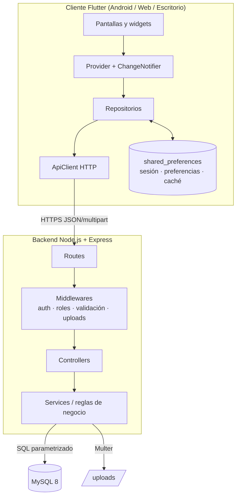
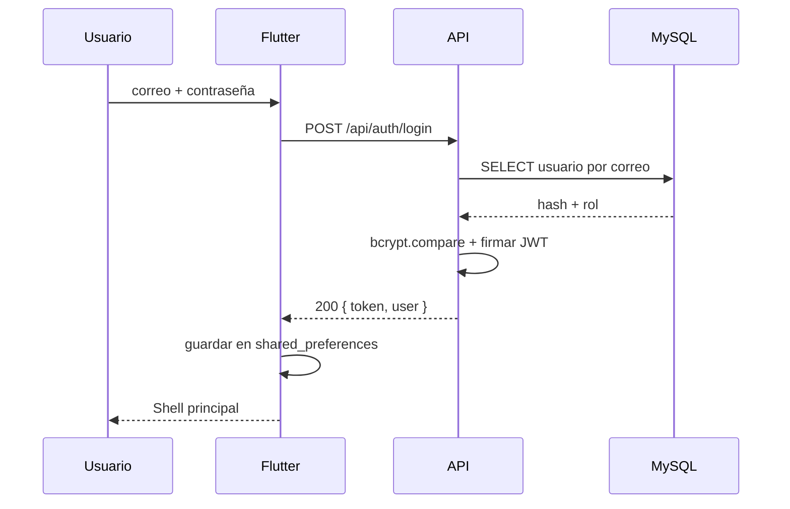
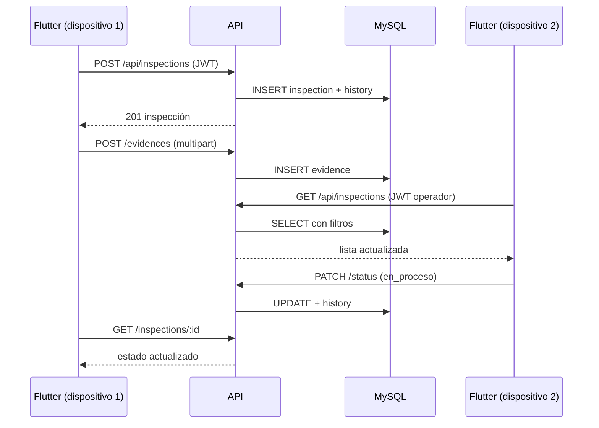

# Arquitectura — SIGSE

Documento de decisiones técnicas y estructura del sistema. Debe mantenerse alineado con el
código y con `docs/PLAN_TRABAJO.md`.

---

## 1. Vista general

SIGSE sigue una arquitectura **cliente-servidor en tres capas**:



Principios:

1. **La app nunca habla con MySQL.** Solo con la API.
2. **El backend es la autoridad** de permisos, transiciones y regla de negocio.
3. **Toda pantalla usa datos reales**; la caché local es solo apoyo offline.
4. **Un solo código Flutter** para Android, web y escritorio, con adaptaciones responsivas.

---

## 2. Cliente Flutter

### 2.1 Capas

| Capa | Responsabilidad | Ejemplos |
| --- | --- | --- |
| `core/` | Infraestructura transversal | `ApiClient`, `SessionStore`, tema, constantes, validadores |
| `features/<x>/models` | Modelos inmutables con `fromJson`/`toJson` | `Inspection`, `User`, `Category` |
| `features/<x>/data` | Repositorios: HTTP + caché | `InspectionsRepository`, `AuthRepository` |
| `features/<x>/state` | `ChangeNotifier` expuestos con Provider | `AuthProvider`, `InspectionsProvider` |
| `features/<x>/screens` | Pantallas | `LoginScreen`, `InspectionDetailScreen` |
| `features/shell` | Navegación responsiva | `NavigationBar` / `NavigationRail` |
| `core/widgets` | Componentes reutilizables | `StatusBadge`, `EmptyState`, `ErrorView` |

Regla de dependencias: `screens → state → data → models/core`. Nunca al revés. Una pantalla no
construye URLs ni maneja `http` directamente.

### 2.2 Gestión de estado

- **Provider + ChangeNotifier** (decisión del equipo).
- `AuthProvider` es global: sesión, usuario, login/logout, restauración desde storage.
- `InspectionsProvider` se crea al entrar al shell autenticado; maneja filtros, paginación,
  caché y estado de carga/error.
- Estados explícitos en UI: `loading`, `data`, `empty`, `error`, `offline`.
- No se usa `setState` para estado compartido; sí para estado puramente visual local.

### 2.3 Navegación

- `AuthGate`: si no hay sesión → Login; si hay → Shell principal.
- Shell responsivo:
  - Ancho < 720 px: `NavigationBar` inferior.
  - Ancho ≥ 720 px: `NavigationRail` lateral.
- Detalle y formulario se abren con `Navigator.push` y reciben el `Inspection` o `id`.
- El panel de operador solo aparece para rol `operador`.

### 2.4 Red y errores

`ApiClient` centraliza:

- URL base desde `--dart-define=API_BASE_URL`.
- Inyección del token `Bearer`.
- Timeout (15 s), parseo JSON y `multipart/form-data`.
- Traducción de errores a `ApiException` con mensaje amigable.
- Detección de `401` para cerrar sesión y volver al login.
- `SocketException`/`TimeoutException`/`ClientException` → mensaje “sin conexión”.

Formato de error del backend:

```json
{ "error": { "message": "Texto para el usuario", "code": "VALIDATION_ERROR", "details": [] } }
```

### 2.5 Persistencia local y offline

- `SessionStore` (envoltura de `shared_preferences`):
  - `auth_token`, `auth_user`, `theme_mode`.
  - `cache_inspections_<userId>`: últimos resultados JSON.
  - `last_sync_<userId>`: marca de tiempo.
- Estrategia **cache-first para lectura**:
  1. Mostrar caché inmediatamente si existe.
  2. Intentar red; si responde, actualizar caché y UI.
  3. Si falla, mantener caché y mostrar banner “Sin conexión · datos del …”.
- Crear/editar requiere red; si falla, se informa y no se pierde el formulario.
- `connectivity_plus` detecta pérdida/restauración para reintentar.
- No se cachean imágenes binarias; se guardan URLs y se muestran con placeholder.

### 2.6 Recursos móviles

| Recurso | Paquete | Uso en SIGSE | Fallback web/escritorio |
| --- | --- | --- | --- |
| Cámara | `image_picker` | Foto de la señal al crear inspección | Selección de archivo |
| Galería | `image_picker` | Elegir evidencia existente | Igual |
| Geolocalización | `geolocator` | Latitud/longitud y precisión | Coordenadas manuales o del navegador |
| Mapa | `flutter_map` + OSM | Ver ubicación en detalle | Igual |
| Acelerómetro | `sensors_plus` | Medir inclinación de la señal (`tilt_degrees`) | Entrada manual / oculto |
| Conectividad | `connectivity_plus` | Modo offline y reintento | Igual |
| Permisos | APIs de cada plugin | Cámara y ubicación | Navegador solicita permisos |

Permisos Android en `AndroidManifest.xml`: `INTERNET`, `CAMERA`,
`ACCESS_FINE_LOCATION`, `ACCESS_COARSE_LOCATION`. Solicitar en runtime con explicación previa.

### 2.7 Gestos y animaciones

- `RefreshIndicator` (pull-to-refresh) en listados.
- `Dismissible` o swipe actions para cancelar (con confirmación).
- `Hero` entre tarjeta y detalle de evidencia.
- `AnimatedSwitcher` para badges de estado y carga.
- `PageView` para galería de evidencias con pinch-to-zoom.
- Long-press en tarjeta para acciones rápidas del operador.
- Respetar `MediaQuery.disableAnimations` (accesibilidad).

### 2.8 Diseño responsivo

- Material 3, `ColorScheme.fromSeed`, modo claro/oscuro persistido.
- Breakpoints: móvil `< 600`, tablet `600–1024`, escritorio `> 1024`.
- Listados en `ListView` en móvil y `GridView`/dos paneles en escritorio.
- Formularios con ancho máximo (~720 px) centrado en pantallas grandes.
- Textos y botones con escalado accesible; contraste adecuado.

---

## 3. Backend

### 3.1 Capas

```text
server.js  → arranque HTTP
app.js     → middlewares globales + montaje de rutas (exportado para tests)
routes     → define endpoints y aplica auth/roles/validación
controllers→ traduce HTTP ↔ servicios, arma respuestas
services   → reglas de negocio y SQL
middleware → authenticate, authorize, validate, upload, errorHandler
config     → env, pool MySQL
validators → esquemas Zod
utils      → ApiError, asyncHandler, paginación, folios
```

### 3.2 Autenticación y autorización

- Registro público: siempre crea `usuario` (nunca permite elegir rol).
- Login: verifica bcrypt y firma JWT `{ sub, role }` con expiración de 8 h.
- Middleware `authenticate`: valida firma, consulta usuario activo y adjunta `req.user`.
- Middleware `authorize('operador')`: rechaza con `403`.
- Reglas de propiedad se validan en el servicio (dueño vs operador).

### 3.3 Máquina de estados

```text
pendiente ──asignar──> asignada ──iniciar──> en_proceso ──finalizar──> finalizada
     │                     │                     │
     └──────cancelar───────┴──────cancelar───────┘──> cancelada
```

- `finalizada` y `cancelada` son terminales.
- Solo `operador` asigna, inicia y finaliza.
- El dueño puede cancelar mientras esté `pendiente`; el operador puede cancelar mientras no
  esté finalizada/cancelada.
- Toda transición se ejecuta en transacción, con `SELECT ... FOR UPDATE`, y escribe en
  `inspection_history`.

### 3.4 Regla de negocio (doble defensa)

Al finalizar:

1. `review_result` debe ser texto no vacío (≥ 10 caracteres).
2. `final_condition` debe pertenecer al catálogo (`buena`, `regular`, `mala`, `reemplazada`).
3. El servicio responde `422` si falta algo.
4. MySQL refuerza con:

```sql
CHECK (status <> 'finalizada' OR (review_result IS NOT NULL AND final_condition IS NOT NULL))
```

### 3.5 Evidencias

- `POST /inspections/:id/evidences` con `multipart/form-data`, campo `file`.
- Multer: disco en `backend/uploads`, nombre aleatorio, límite 8 MB, solo imágenes
  (`jpeg`, `png`, `webp`, `heic`) y PDF opcional.
- Se guarda ruta relativa `/uploads/...`; el cliente resuelve contra la URL base.
- Borrado en cascada de la fila al eliminar la inspección; el archivo físico se limpia en el
  servicio (best effort).
- **Riesgo de despliegue:** disco efímero. En producción usar volumen persistente o
  Cloudinary/S3; documentar la elección.

### 3.6 Validación y errores

- Zod valida `body`, `query` y `params`.
- Códigos: `400` JSON malformado, `401` sin token/Token inválido, `403` sin permiso,
  `404` no existe, `409` conflicto (correo duplicado), `422` validación/regla de negocio,
  `500` error inesperado.
- Nunca se filtra el stack trace ni detalles de SQL en producción.
- `asyncHandler` captura promesas rechazadas.

---

## 4. Base de datos

- MySQL 8, InnoDB, `utf8mb4_unicode_ci`.
- Llaves foráneas con `ON DELETE RESTRICT` (usuarios/categorías) y `CASCADE` (evidencias e
  historial al borrar inspección, si se permite).
- Índices para filtros: `status`, `category_id`, `created_by`, `assigned_to`, `created_at`.
- Fechas en UTC (`TIMESTAMP`), el cliente las presenta en hora local.
- Diccionario y ER: `docs/MODELO_DATOS.md`.

---

## 5. Flujos clave

### 5.1 Login



### 5.2 Crear inspección desde un dispositivo y verla en otro



### 5.3 Finalización

1. Operador abre el panel y elige “Finalizar”.
2. UI muestra formulario obligatorio: resultado de revisión y condición final.
3. `PATCH /inspections/:id/status` con `{ status: "finalizada", reviewResult, finalCondition }`.
4. Servicio valida regla, actualiza fechas y registra historial.
5. Si falta algo → `422`; la UI muestra el error y no cierra el caso.

---

## 6. Despliegue

### 6.1 Topología recomendada (gratuita)

```text
[Flutter Web estático]  →  Firebase Hosting / Netlify / GitHub Pages
[API Express]           →  Railway / Render
[MySQL 8]               →  Railway MySQL / Aiven / Clever Cloud
[APK Android]           →  artifact de GitHub Releases
[Escritorio]            →  build Linux/Windows en Releases
```

Alternativa académica: backend y MySQL en una computadora del equipo + túnel
(Cloudflare Tunnel/ngrok) para que otros dispositivos accedan.

### 6.2 Variables de entorno del backend

```env
NODE_ENV=production
PORT=3000
DB_HOST=...
DB_PORT=3306
DB_USER=...
DB_PASSWORD=...
DB_NAME=sigse
JWT_SECRET=<cadena larga aleatoria>
JWT_EXPIRES_IN=8h
CORS_ORIGIN=https://tu-web.example.com
PUBLIC_BASE_URL=https://tu-api.example.com
UPLOAD_DIR=uploads
MAX_UPLOAD_MB=8
```

- `CORS_ORIGIN` debe listar el dominio web real, no `*` en producción.
- `PUBLIC_BASE_URL` se usa para construir URLs absolutas de evidencias.
- Cambiar `JWT_SECRET` y contraseñas demo antes de publicar.

### 6.3 Builds

```bash
# Web
flutter build web --release --dart-define=API_BASE_URL=https://api.example.com/api
# APK
flutter build apk --release --dart-define=API_BASE_URL=https://api.example.com/api
# Linux
flutter build linux --release --dart-define=API_BASE_URL=https://api.example.com/api
# Windows (en Windows)
flutter build windows --release --dart-define=API_BASE_URL=https://api.example.com/api
```

El APK se firma; no subir `key.properties` ni el keystore. Publicar el `.apk` como Release.

### 6.4 Checklist de despliegue

- [ ] DB creada con schema + seed.
- [ ] API responde `/api/health` y `/api/health/db`.
- [ ] CORS configurado para el dominio web.
- [ ] Login funciona desde web y Android.
- [ ] Uploads persisten tras reinicio.
- [ ] Variables de entorno configuradas (sin secretos en el repo).
- [ ] Web publicada y accesible.
- [ ] APK instalado en dispositivo físico.
- [ ] Prueba 9.1 entre dos dispositivos.

---

## 7. Seguridad

- Contraseñas con bcrypt (coste 10+), nunca en texto plano ni en logs.
- JWT con expiración; no guardar secretos en el cliente.
- Validación y autorización en cada endpoint sensible.
- Consultas parametrizadas; nunca concatenar SQL con entrada del usuario.
- Rate limiting en login (recomendado) y límites de tamaño de archivo.
- `helmet` para cabeceras; CORS restringido.
- Sanitizar nombres de archivo y validar MIME real.
- No exponer `.env`, `uploads` con listado de directorios ni stack traces.
- Datos de prueba sin información personal sensible.

## 8. Decisiones pendientes

| Tema | Estado | Responsable |
| --- | --- | --- |
| Servicio de hosting definitivo | Por definir en Sprint 3 | Edson |
| Volumen persistente vs Cloudinary | Por definir según hosting | Edson + Alonso |
| Firma del APK | Por definir | Edson |
| Rate limiting | Opcional si hay tiempo | Diana |
