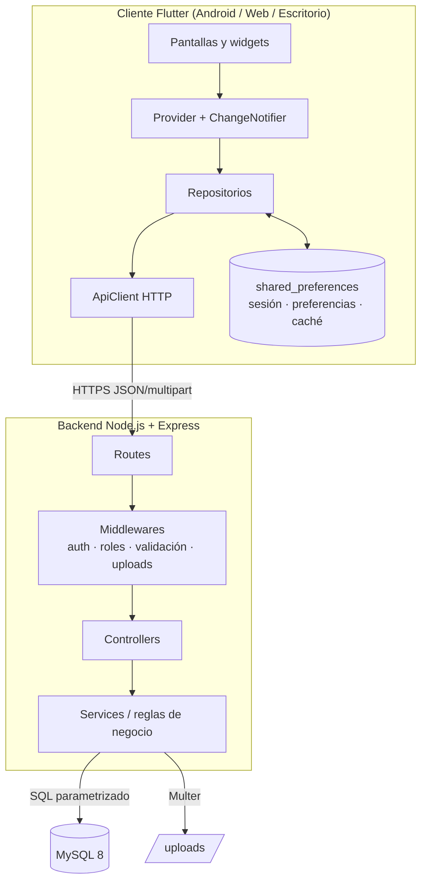
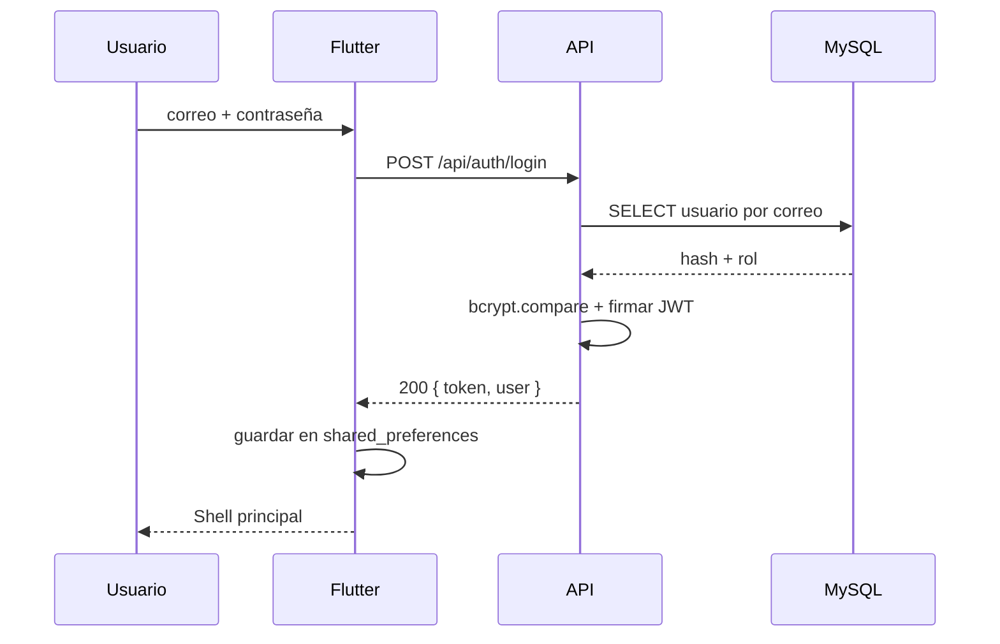
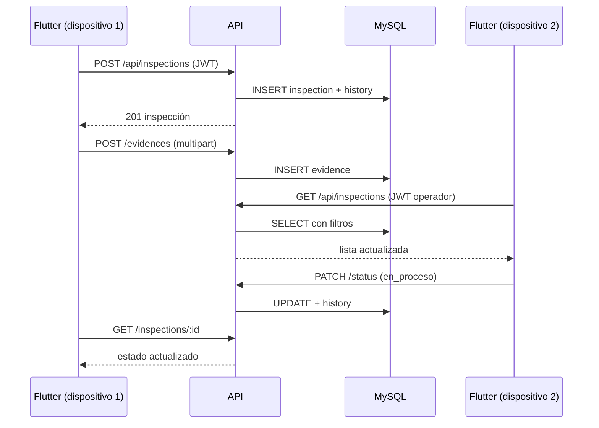

# Arquitectura — SIGSE

Documento de decisiones técnicas y estructura del sistema. Debe mantenerse alineado con el
código y con `docs/PLAN_TRABAJO.md`.

---

## 1. Vista general

SIGSE sigue una arquitectura **cliente-servidor en tres capas**:



Principios:

1. **La app nunca habla con MySQL.** Solo con la API.
2. **El backend es la autoridad** de permisos, transiciones y regla de negocio.
3. **Toda pantalla usa datos reales**; la caché local es solo apoyo offline.
4. **Un solo código Flutter** para Android, web y escritorio, con adaptaciones responsivas.

---

## 2. Cliente Flutter

### 2.1 Capas

| Capa | Responsabilidad | Ejemplos |
| --- | --- | --- |
| `core/` | Infraestructura transversal | `ApiClient`, `LocalStorage`, `AppConfig`, `AppRoutes`, tema, constantes |
| `features/<x>/models` | Modelos inmutables con `fromJson`/`toJson` | `Inspection`, `Category` |
| `features/<x>/data` | Repositorios: HTTP + caché | `InspectionsRepository`, `AuthRepository` |
| `features/<x>/state` | `ChangeNotifier` expuestos con Provider | `AuthProvider`, `InspectionsProvider` |
| `features/<x>/screens` | Pantallas | `LoginScreen`, `InspectionDetailScreen` |
| `features/shell` | Navegación responsiva | `NavigationBar` / `NavigationRail` |
| `core/widgets` | Componentes reutilizables | `StatusBadge`, `EmptyState`, `ErrorView` |

Regla de dependencias: `screens → state → data → models/core`. Nunca al revés. Una pantalla no
construye URLs ni maneja `http` directamente.

### 2.2 Gestión de estado

- **Provider + ChangeNotifier** (decisión del equipo).
- `AuthProvider` es global: sesión, usuario, login/logout, restauración desde storage.
- `InspectionsProvider` se crea al entrar al shell autenticado; maneja filtros, paginación,
  caché y estado de carga/error.
- Estados explícitos en UI: `loading`, `data`, `empty`, `error`, `offline`.
- No se usa `setState` para estado compartido; sí para estado puramente visual local.

### 2.3 Navegación

- `AuthGate`: si no hay sesión → Login; si hay → Shell principal.
- Shell responsivo:
  - Ancho < 720 px: `NavigationBar` inferior.
  - Ancho ≥ 720 px: `NavigationRail` lateral.
- Detalle y formulario se abren con `Navigator.push` y reciben el `Inspection` o `id`.
- El panel de operador solo aparece para rol `operador`.

### 2.4 Red y errores

`ApiClient` centraliza:

- URL base desde `--dart-define=API_BASE_URL`.
- Inyección del token `Bearer`.
- Timeout (20 s), parseo JSON y `multipart/form-data`.
- En emulador Android la URL local es `http://10.0.2.2:3000/api`; en web/escritorio es
  `http://localhost:3000/api`.
- Traducción de errores a `ApiException` con mensaje amigable.
- Detección de `401` para cerrar sesión y volver al login. `ApiClient` solo lanza
  `ApiException` con `statusCode`; quien decide cerrar sesión es `AuthProvider` (tarea E3).
- `SocketException`/`TimeoutException`/`ClientException` → mensaje “sin conexión”.

Formato de error del backend:

```json
{ "error": { "message": "Texto para el usuario", "code": "VALIDATION_ERROR", "details": [] } }
```

### 2.5 Persistencia local y offline

- `LocalStorage` (envoltura de `shared_preferences`, **ya implementada** en `core/storage/`) y,
  sobre ella, `SessionStore` (**pendiente, se crea en la tarea E3** junto con la auth UI):
  - `auth_token`, `auth_user`, `theme_mode`.
  - `cache_inspections_<userId>`: últimos resultados JSON.
  - `last_sync_<userId>`: marca de tiempo.
- Estrategia **cache-first para lectura**:
  1. Mostrar caché inmediatamente si existe.
  2. Intentar red; si responde, actualizar caché y UI.
  3. Si falla, mantener caché y mostrar banner “Sin conexión · datos del …”.
- Crear/editar requiere red; si falla, se informa y no se pierde el formulario.
- `connectivity_plus` detecta pérdida/restauración para reintentar.
- No se cachean imágenes binarias; se guardan URLs y se muestran con placeholder.

### 2.6 Recursos móviles

| Recurso | Paquete | Uso en SIGSE | Fallback web/escritorio |
| --- | --- | --- | --- |
| Cámara | `image_picker` | Foto de la señal al crear inspección | Selección de archivo |
| Galería | `image_picker` | Elegir evidencia existente | Igual |
| Geolocalización | `geolocator` | Latitud/longitud y precisión | Coordenadas manuales o del navegador |
| Mapa | `flutter_map` + OSM | Ver ubicación en detalle | Igual |
| Acelerómetro | `sensors_plus` | Medir inclinación de la señal (`tilt_degrees`) | Entrada manual / oculto |
| Conectividad | `connectivity_plus` | Modo offline y reintento | Igual |
| Permisos | APIs de cada plugin | Cámara y ubicación | Navegador solicita permisos |

Permisos Android en `AndroidManifest.xml`: `INTERNET`, `CAMERA`,
`ACCESS_FINE_LOCATION`, `ACCESS_COARSE_LOCATION`. Solicitar en runtime con explicación previa.

### 2.7 Gestos y animaciones

- `RefreshIndicator` (pull-to-refresh) en listados.
- `Dismissible` o swipe actions para cancelar (con confirmación).
- `Hero` entre tarjeta y detalle de evidencia.
- `AnimatedSwitcher` para badges de estado y carga.
- `PageView` para galería de evidencias con pinch-to-zoom.
- Long-press en tarjeta para acciones rápidas del operador.
- Respetar `MediaQuery.disableAnimations` (accesibilidad).

### 2.8 Diseño responsivo

- Material 3, `ColorScheme.fromSeed`, modo claro/oscuro persistido.
- Breakpoints: móvil `< 600`, tablet `600–1024`, escritorio `> 1024`.
- Listados en `ListView` en móvil y `GridView`/dos paneles en escritorio.
- Formularios con ancho máximo (~720 px) centrado en pantallas grandes.
- Textos y botones con escalado accesible; contraste adecuado.

---

## 3. Backend

### 3.1 Capas

```text
server.js  → arranque HTTP
app.js     → middlewares globales + montaje de rutas (exportado para tests)
routes       → define endpoints y aplica auth/roles/validación
controllers  → traduce HTTP ↔ servicios, arma respuestas
services     → reglas de negocio (sin SQL)
repositories → acceso a MySQL, consultas parametrizadas (permite probar servicios sin base)
middleware   → authenticate, authorize, validate, upload, errorHandler
config.js    → lectura y validación de variables de entorno (p. ej. JWT_SECRET)
serializers.js → única traducción fila (snake_case) → JSON (camelCase)
validators   → esquemas Zod
testing/     → ayudantes de pruebas (repositorios en memoria); no se publica en Docker
utils      → ApiError, asyncHandler, paginación, folios
```

### 3.2 Autenticación y autorización

- Registro público: siempre crea `usuario` (nunca permite elegir rol).
- Login: verifica bcrypt y firma JWT `{ sub, role }` con expiración de 8 h.
- Middleware `authenticate`: valida firma (solo HS256), consulta al usuario en la base y adjunta `req.user` `{ id, name, email, role }`. **El rol sale de la base, no del token**, y un usuario dado de baja pierde el acceso al instante.
- El servidor **no arranca** si `JWT_SECRET` falta o mide menos de 32 caracteres, si es el valor de ejemplo de `.env.example` (solo se permite con `NODE_ENV=development` o `test`) o si `JWT_EXPIRES_IN` no es válido.
- La contraseña se limita a **72 bytes** (límite real de bcrypt), no a 72 caracteres.
- Los errores inesperados de MySQL se registran solo con `code`, `errno` y `sqlState`: el mensaje y la consulta pueden traer correos y hashes.
- Login: correo inexistente y contraseña incorrecta dan la misma respuesta `401` (y se compara un hash falso con el mismo coste que el seed, 12, para igualar tiempos).
- Middleware `authorize('operador')`: rechaza con `403`.
- Reglas de propiedad se validan en el servicio (dueño vs operador).

### 3.3 Máquina de estados

```text
pendiente ──asignar──> asignada ──iniciar──> en_proceso ──finalizar──> finalizada
     │                     │                     │
     └──────cancelar───────┴──────cancelar───────┘──> cancelada
```

- `finalizada` y `cancelada` son terminales.
- Solo `operador` asigna, inicia y finaliza.
- El dueño puede cancelar mientras esté `pendiente`; el operador puede cancelar mientras no
  esté finalizada/cancelada.
- Toda transición se ejecuta en transacción, con `SELECT ... FOR UPDATE`, y escribe en
  `inspection_history`.

### 3.4 Regla de negocio (doble defensa)

Al finalizar:

1. `review_result` debe ser texto no vacío (≥ 10 caracteres).
2. `final_condition` debe pertenecer al catálogo (`buena`, `regular`, `mala`, `reemplazada`).
3. El servicio responde `422` si falta algo.
4. MySQL refuerza con:

```sql
CHECK (status <> 'finalizada' OR (review_result IS NOT NULL AND final_condition IS NOT NULL))
```

### 3.5 Evidencias

- `POST /inspections/:id/evidences` con `multipart/form-data`, campo `file`.
- Multer recibe el archivo en un directorio temporal con límite de 8 MB. Antes de guardarlo
  se verifica su formato por contenido (JPEG, PNG, WebP, HEIC o PDF).
- La ruta `/uploads/...` se vincula a la evidencia en MySQL. La descarga exige JWT y está
  restringida al dueño de la inspección o a un operador.
- El servicio borra los temporales después de procesar la solicitud. Al eliminar una evidencia,
  confirma el borrado de sus datos y el evento de historial antes de intentar limpiar el disco.
- En Docker, usa un volumen persistente en `/app/uploads` o configura `UPLOAD_DIR` con otra
  ruta donde pueda escribir el proceso de Node.

### 3.6 Validación y errores

- Zod valida `body`, `query` y `params`.
- Códigos: `400` JSON malformado, `401` sin token/Token inválido, `403` sin permiso,
  `404` no existe, `409` conflicto (correo duplicado), `422` validación/regla de negocio,
  `500` error inesperado.
- Nunca se filtra el stack trace ni detalles de SQL en producción.
- `asyncHandler` captura promesas rechazadas.

---

## 4. Base de datos

- MySQL 8, InnoDB, `utf8mb4_unicode_ci`.
- Llaves foráneas con `ON DELETE RESTRICT` (usuarios/categorías) y `CASCADE` (evidencias e
  historial al borrar inspección, si se permite).
- Índices para filtros: `status`, `category_id`, `created_by`, `assigned_to`, `created_at`.
- Fechas en UTC (`TIMESTAMP`), el cliente las presenta en hora local.
- Diccionario y ER: `docs/MODELO_DATOS.md`.

---

## 5. Flujos clave

### 5.1 Login



### 5.2 Crear inspección desde un dispositivo y verla en otro



### 5.3 Finalización

1. Operador abre el panel y elige “Finalizar”.
2. UI muestra formulario obligatorio: resultado de revisión y condición final.
3. `PATCH /inspections/:id/status` con `{ status: "finalizada", reviewResult, finalCondition }`.
4. Servicio valida regla, actualiza fechas y registra historial.
5. Si falta algo → `422`; la UI muestra el error y no cierra el caso.

---

## 6. Despliegue

### 6.1 Solución final recomendada: un VPS con Docker

Para la entrega se recomienda **un solo VPS** (servidor privado virtual) con Ubuntu 24.04 LTS.
Es la opción más simple para cumplir con el despliegue y evita depender de varios servicios
gratuitos que se duermen o cambian sus límites.

```text
Internet
   │
   ├── 80/443 ──► Caddy ──► /       Flutter Web (archivos estáticos)
   │                 └────► /api    Node.js + Express
   │                 └────► /uploads evidencias
   │
   └── 22 ─────► SSH (solo administración)

Node.js ──► MySQL 8 (red interna de Docker, sin puerto público)
Node.js ──► volumen persistente para uploads
```

#### Especificaciones sugeridas

| Recurso | Mínimo | Recomendado |
| --- | --- | --- |
| CPU | 1 vCPU | 2 vCPU |
| RAM | 2 GB | 4 GB |
| Disco | 40 GB SSD | 60–80 GB SSD |
| Sistema | Ubuntu 24.04 LTS | Ubuntu 24.04 LTS |
| Red | IP pública + dominio | Dominio con HTTPS |

Proveedores habituales: Hetzner, DigitalOcean, Vultr o Linode. El costo aproximado es de
**5–10 USD al mes**; el dominio cuesta aparte. Los builds de Flutter se hacen en la máquina
local o en CI, no en el VPS.

**Ejemplo concreto en Hetzner:** Cloud **CX23** (sucesor del CX22), 2 vCPU, 4 GB de RAM,
40 GB NVMe, 20 TB de tráfico, imagen **Ubuntu 24.04 LTS**, ubicación Falkenstein o Helsinki,
con IPv4 pública. Cuesta aproximadamente **€5.99 al mes + IVA**; los respaldos automáticos
agregan ~20 %. No se necesita volumen extra, base administrada, IP flotante ni balanceador.
Si CX23 no está disponible por la restricción de inventario de Hetzner, una alternativa es
**CAX11** (ARM, 2 vCPU, 4 GB, 40 GB) o cambiar de proveedor.

#### Por qué la base de datos no debe ser pública

La base **no necesita** estar expuesta a internet para que el sistema funcione. Solo el
backend necesita una dirección pública. MySQL se queda en la red interna de Docker y:

- no se publica el puerto `3306` en `docker-compose.yml`;
- el firewall solo permite `22`, `80` y `443`;
- el backend se conecta usando el nombre interno `db:3306`;
- las copias de seguridad se hacen por SSH o un Cron del servidor.

El profesor puede verificar la conexión con `GET /api/health/db`, con el login funcionando y
con una consulta por SSH. No hace falta abrir MySQL a internet. Si se usa un MySQL administrado,
tendrá un endpoint, pero se protege con firewall, usuario limitado, contraseña fuerte y TLS.

#### Pasos de despliegue

1. Crear el VPS con llave SSH, usuario sin privilegios y firewall (22, 80, 443).
2. Apuntar el dominio al IP del VPS con un registro `A`.
3. Instalar Docker Engine y el plugin `docker compose`.
4. Clonar el repositorio y crear `.env` a partir de `.env.example`.
5. Generar el build web y el APK apuntando a `https://TU_DOMINIO/api`.
6. Levantar los servicios con `docker compose up -d --build`.
7. Cargar **solo** `schema.sql`. **No cargar `seed.sql` en producción**: crea operadores con la
   contraseña de demo `SigseDemo2026!`, que es pública en el repositorio. Después:
   - Crear el primer operador con una contraseña propia. Genera el hash con
     `node -e "console.log(require('bcryptjs').hashSync(process.argv[1], 12))" 'TuContraseñaLarga1'`
     e insértalo con
     `INSERT INTO users (name, email, password_hash, role) VALUES ('Nombre', 'correo', '<hash>', 'operador');`
   - Crear las categorías desde la app o con `POST /api/categories` como ese operador.
8. Verificar `/api/health`, `/api/health/db`, login, subida de foto y acceso desde dos
   dispositivos.
9. Programar respaldo de MySQL y del volumen de uploads.
10. Opcional: agregar despliegue automático desde GitHub Actions por SSH.

#### Caddy como proxy y HTTPS

Caddy simplifica el certificado TLS automático y sirve la web y la API bajo el mismo dominio,
lo que evita problemas de CORS:

```caddyfile
{$DOMAIN} {
    encode gzip

    handle /api/* {
        reverse_proxy api:3000
    }

    handle /uploads/* {
        reverse_proxy api:3000
    }

    handle {
        root * /srv
        try_files {path} /index.html
        file_server
    }
}
```

#### Referencia de `docker-compose.yml`

Este archivo se activa cuando existan `backend/Dockerfile` y el build web. La base de datos no
publica puertos:

```yaml
services:
  db:
    image: mysql:8.4
    restart: unless-stopped
    environment:
      MYSQL_DATABASE: ${DB_NAME}
      MYSQL_USER: ${DB_USER}
      MYSQL_PASSWORD: ${DB_PASSWORD}
      MYSQL_ROOT_PASSWORD: ${DB_ROOT_PASSWORD}
    volumes:
      - mysql_data:/var/lib/mysql
    healthcheck:
      test: ["CMD", "mysqladmin", "ping", "-h", "localhost"]
      interval: 10s
      timeout: 5s
      retries: 10

  api:
    build: ./backend
    restart: unless-stopped
    env_file: .env
    depends_on:
      db:
        condition: service_healthy
    volumes:
      - uploads:/app/uploads

  caddy:
    image: caddy:2-alpine
    restart: unless-stopped
    ports:
      - "80:80"
      - "443:443"
    environment:
      DOMAIN: ${DOMAIN}
    volumes:
      - ./app/build/web:/srv:ro
      - ./Caddyfile:/etc/caddy/Caddyfile:ro
      - caddy_data:/data
      - caddy_config:/config
    depends_on:
      - api

volumes:
  mysql_data:
  uploads:
  caddy_data:
  caddy_config:
```

#### Costos y responsables

| Concepto | Costo estimado | Nota |
| --- | ---: | --- |
| VPS | 5–10 USD/mes | Puede ser 0 con créditos de estudiante u Oracle Free Tier |
| Dominio | 10–15 USD/año | Opcional; se puede usar un subdominio gratuito para la demo |
| HTTPS | 0 | Caddy obtiene el certificado con Let's Encrypt |
| GitHub y GitHub Actions | 0 | Gratis para repositorios públicos |
| Mapas | 0 | OpenStreetMap, sin API key |
| Firma de APK | 0 | Se firma con un keystore propio |
| iOS | No aplica | Evita los 99 USD/año de Apple; no es requisito |
| MySQL administrado | 5–15 USD/mes extra | No es necesario si la DB va dentro del VPS |
| Almacenamiento externo | 0–5 USD/mes | No es necesario si se usa un volumen del VPS |

**Trabajo:** el despliegue es la tarea **E4 de Edson** (7 puntos). Diana apoya con la base de
datos y Alonso con uploads, pruebas móviles y verificación desde otro dispositivo (A5). Todos
deben saber explicar la topología en la defensa.

**Dinero:** el profesor no exige un hosting de pago. Si se usa Oracle Free Tier o créditos de
GitHub Student Pack, el costo puede ser **0**. Si se contrata un VPS, el equipo decide si se
divide en partes iguales o se reembolsa a quien pague.

#### ¿Cumple con lo que pide el profesor?

| Requisito | Cómo se cumple |
| --- | --- |
| Backend desplegado y accesible | `https://TU_DOMINIO/api` |
| Base de datos central persistente | MySQL con volumen `mysql_data` |
| Web publicada | Flutter Web servido por Caddy |
| Android ejecutable en físico | APK firmado apuntando al dominio |
| Escritorio ejecutable | Build Linux/Windows apuntando al dominio |
| Comunicación entre dispositivos | Todos usan el mismo backend y la misma DB |
| Evidencias persistentes | Volumen `uploads` |
| Historial y reglas de negocio | Se validan en el backend, no en la DB pública |

### 6.2 Alternativa sin VPS

Si no se quiere administrar un servidor:

- Web estática en Netlify, Vercel o GitHub Pages.
- API en Render, Railway o Fly.io.
- MySQL en Railway, Aiven o Clever Cloud.
- APK y builds de escritorio en GitHub Releases.

Funciona, pero hay más piezas, más variables de entorno, posibles arranques en frío y límites
gratuitos que cambian. Para una demo académica estable, el VPS único es más predecible.

### 6.3 Variables de entorno del backend

```env
NODE_ENV=production
PORT=3000
DB_HOST=...
DB_PORT=3306
DB_USER=...
DB_PASSWORD=...
DB_NAME=sigse
JWT_SECRET=<cadena larga aleatoria>
JWT_EXPIRES_IN=8h
CORS_ORIGIN=https://tu-web.example.com
PUBLIC_BASE_URL=https://tu-api.example.com
UPLOAD_DIR=uploads
MAX_UPLOAD_MB=8
```

- `CORS_ORIGIN` debe listar el dominio web real, no `*` en producción.
- `PUBLIC_BASE_URL` se usa para construir URLs absolutas de evidencias.
- Cambiar `JWT_SECRET` y contraseñas demo antes de publicar.

### 6.4 Builds

```bash
# Web
flutter build web --release --dart-define=API_BASE_URL=https://api.example.com/api
# APK
flutter build apk --release --dart-define=API_BASE_URL=https://api.example.com/api
# Linux
flutter build linux --release --dart-define=API_BASE_URL=https://api.example.com/api
# Windows (en Windows)
flutter build windows --release --dart-define=API_BASE_URL=https://api.example.com/api
```

El APK se firma; no subir `key.properties` ni el keystore. Publicar el `.apk` como Release.

### 6.5 Checklist de despliegue

- [ ] DB creada solo con `schema.sql` (sin `seed.sql`), con un operador de contraseña propia.
- [ ] MySQL no expone el puerto `3306` a internet.
- [ ] HTTPS activo y redirección desde HTTP.
- [ ] API responde `/api/health` y `/api/health/db`.
- [ ] CORS configurado para el dominio web.
- [ ] Login funciona desde web y Android.
- [ ] Uploads persisten tras reinicio.
- [ ] Respaldo de MySQL y de uploads programado.
- [ ] Variables de entorno configuradas (sin secretos en el repo), con `NODE_ENV=production` y un `JWT_SECRET` propio.
- [ ] Cuentas de demo del seed inexistentes (`operador1@example.com`, `usuario@example.com`...).
- [ ] Web publicada y accesible.
- [ ] APK instalado en dispositivo físico.
- [ ] Prueba 9.1 entre dos dispositivos.

---

## 7. Seguridad

- Contraseñas con bcrypt (coste 10+), nunca en texto plano ni en logs.
- JWT con expiración; no guardar secretos en el cliente.
- Validación y autorización en cada endpoint sensible.
- Consultas parametrizadas; nunca concatenar SQL con entrada del usuario.
- Rate limiting en login (recomendado) y límites de tamaño de archivo.
- `helmet` para cabeceras; CORS restringido.
- Sanitizar nombres de archivo y validar MIME real.
- No exponer `.env`, `uploads` con listado de directorios ni stack traces.
- Datos de prueba sin información personal sensible.

## 8. Decisiones pendientes

| Tema | Estado | Responsable |
| --- | --- | --- |
| Servicio de hosting definitivo | Recomendado: VPS único; confirmar proveedor en Sprint 3 | Edson |
| Volumen persistente vs Cloudinary | Recomendado: volumen Docker en el VPS | Edson + Alonso |
| Firma del APK | Por definir | Edson |
| Rate limiting del login | Pendiente: E6 no lo incluye; **obligatorio antes de publicar** (p. ej. `express-rate-limit` en `/auth/login`). Issue: por crear | Diana |
