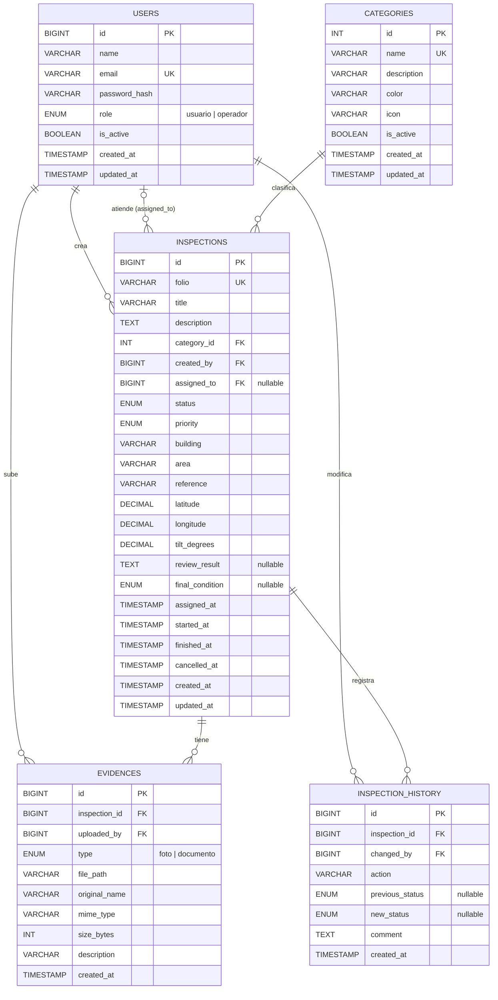

# Modelo de datos — SIGSE

Motor: **MySQL 8** · InnoDB · `utf8mb4_unicode_ci` · fechas en UTC.

---

## 1. Diagrama entidad-relación



---

## 2. Diccionario de tablas

### 2.1 `users`

| Columna | Tipo | Restricciones | Descripción |
| --- | --- | --- | --- |
| `id` | BIGINT UNSIGNED | PK, AUTO_INCREMENT | Identificador |
| `name` | VARCHAR(120) | NOT NULL | Nombre completo |
| `email` | VARCHAR(150) | NOT NULL, UNIQUE | Correo institucional |
| `password_hash` | VARCHAR(255) | NOT NULL | bcrypt (nunca texto plano) |
| `role` | ENUM | NOT NULL, default `usuario` | `usuario` o `operador` |
| `is_active` | BOOLEAN | NOT NULL, default 1 | Baja lógica |
| `created_at` | TIMESTAMP | default CURRENT_TIMESTAMP | Alta |
| `updated_at` | TIMESTAMP | ON UPDATE | Última modificación |

### 2.2 `categories`

| Columna | Tipo | Restricciones | Descripción |
| --- | --- | --- | --- |
| `id` | INT UNSIGNED | PK, AUTO_INCREMENT | Identificador |
| `name` | VARCHAR(100) | NOT NULL, UNIQUE | Nombre de la categoría |
| `description` | VARCHAR(255) | NULL | Descripción |
| `color` | CHAR(7) | NULL | Color hex para UI (`#RRGGBB`) |
| `icon` | VARCHAR(50) | NULL | Nombre de icono Material |
| `is_active` | BOOLEAN | NOT NULL, default 1 | Disponible para nuevas inspecciones |
| `created_at`, `updated_at` | TIMESTAMP | | Auditoría |

Categorías iniciales: evacuación, rutas de circulación, equipo contra incendio, seguridad,
informativa.

### 2.3 `inspections` (registro principal)

| Columna | Tipo | Restricciones | Descripción |
| --- | --- | --- | --- |
| `id` | BIGINT UNSIGNED | PK, AUTO_INCREMENT | Identificador |
| `folio` | VARCHAR(24) | UNIQUE. Se genera con el año UTC y el ID dentro de la transacción de creación. | `SIG-2026-00001` |
| `title` | VARCHAR(150) | NOT NULL | Resumen del hallazgo |
| `description` | TEXT | NOT NULL | Observaciones del usuario |
| `category_id` | INT UNSIGNED | FK `categories.id`, NOT NULL | Clasificación |
| `created_by` | BIGINT UNSIGNED | FK `users.id`, NOT NULL | Usuario que reporta |
| `assigned_to` | BIGINT UNSIGNED | FK `users.id`, NULL | Operador asignado |
| `status` | ENUM | NOT NULL, default `pendiente` | Estado actual |
| `priority` | ENUM | NOT NULL, default `media` | `baja`, `media`, `alta` |
| `building` | VARCHAR(120) | NULL | Edificio |
| `area` | VARCHAR(120) | NULL | Área/zona |
| `reference` | VARCHAR(255) | NULL | Referencia textual |
| `latitude` | DECIMAL(10,7) | NULL, CHECK | −90 a 90 |
| `longitude` | DECIMAL(10,7) | NULL, CHECK | −180 a 180 |
| `tilt_degrees` | DECIMAL(5,2) | NULL | Inclinación medida con acelerómetro |
| `review_result` | TEXT | NULL | Resultado de la revisión (obligatorio al finalizar) |
| `final_condition` | ENUM | NULL | `buena`, `regular`, `mala`, `reemplazada` |
| `assigned_at` | TIMESTAMP | NULL | Hito de asignación |
| `started_at` | TIMESTAMP | NULL | Inicio de atención |
| `finished_at` | TIMESTAMP | NULL | Finalización |
| `cancelled_at` | TIMESTAMP | NULL | Cancelación |
| `created_at`, `updated_at` | TIMESTAMP | | Auditoría |

**Restricciones clave:**

```sql
CONSTRAINT chk_finalizacion CHECK (
  status <> 'finalizada'
  OR (review_result IS NOT NULL AND final_condition IS NOT NULL)
)
```

La regla se valida también en el backend (doble defensa).

### 2.4 `evidences`

| Columna | Tipo | Restricciones | Descripción |
| --- | --- | --- | --- |
| `id` | BIGINT UNSIGNED | PK | Identificador |
| `inspection_id` | BIGINT UNSIGNED | FK, ON DELETE CASCADE | Inspección |
| `uploaded_by` | BIGINT UNSIGNED | FK `users.id` | Autor de la carga |
| `type` | ENUM | `foto` / `documento` | Tipo |
| `file_path` | VARCHAR(500) | NOT NULL | Ruta relativa `/uploads/...` |
| `original_name` | VARCHAR(255) | NOT NULL | Nombre original |
| `mime_type` | VARCHAR(100) | NOT NULL | MIME validado |
| `size_bytes` | INT UNSIGNED | NOT NULL | Tamaño |
| `description` | VARCHAR(255) | NULL | Nota |
| `created_at` | TIMESTAMP | | Alta |

### 2.5 `inspection_history`

| Columna | Tipo | Restricciones | Descripción |
| --- | --- | --- | --- |
| `id` | BIGINT UNSIGNED | PK | Identificador |
| `inspection_id` | BIGINT UNSIGNED | FK, ON DELETE CASCADE | Inspección |
| `changed_by` | BIGINT UNSIGNED | FK `users.id` | Actor |
| `action` | VARCHAR(40) | NOT NULL | `creacion`, `actualizacion`, `asignacion`, `cambio_estado`, `evidencia`, `cancelacion`, `finalizacion` |
| `previous_status` | ENUM | NULL | Estado anterior |
| `new_status` | ENUM | NULL | Estado nuevo |
| `comment` | TEXT | NULL | Motivo/nota |
| `created_at` | TIMESTAMP | | Fecha |

`inspection_history` es **append-only**: no se actualiza ni se borra desde la aplicación.

---

## 3. Estados y transiciones

| Estado | Significado | Quién entra |
| --- | --- | --- |
| `pendiente` | Reportada, sin responsable | Usuario al crear |
| `asignada` | Operador asignado, aún sin iniciar | Operador |
| `en_proceso` | Atención iniciada | Operador |
| `finalizada` | Cerrada con resultado y condición | Operador (regla) |
| `cancelada` | Descartada | Dueño (si pendiente) u operador |

```text
pendiente  → asignada   → en_proceso → finalizada
    │            │            │
    └────────────┴────────────┴──→ cancelada
```

| Transición | Rol permitido | Condiciones |
| --- | --- | --- |
| `pendiente → asignada` | operador | `assigned_to` válido (operador activo) |
| `asignada → en_proceso` | operador | Debe existir asignado |
| `en_proceso → finalizada` | operador | `review_result` ≥ 10 caracteres y `final_condition` válida |
| `pendiente → cancelada` | dueño u operador | Sin restricciones adicionales |
| `asignada → cancelada` | operador | — |
| `en_proceso → cancelada` | operador | — |
| Cualquier otra | — | `422` |

Toda transición actualiza la fecha del hito, el estado y agrega una fila al historial dentro de
una transacción.

---

## 4. Roles y permisos

| Acción | Usuario | Operador | Notas |
| --- | :---: | :---: | --- |
| Registrarse / login | ✅ | ✅ | Registro siempre crea `usuario` |
| Ver sus inspecciones | ✅ | ✅ | Filtro por `created_by` |
| Ver todas las inspecciones | ❌ | ✅ | — |
| Crear inspección | ✅ | ✅ | Queda como dueño |
| Editar inspección | ✅ solo si `pendiente` y es dueño | ✅ hasta antes de finalizar | Campos acotados |
| Cancelar | ✅ solo si `pendiente` y es dueño | ✅ si no está finalizada | — |
| Asignar / iniciar / finalizar | ❌ | ✅ | Regla de negocio |
| Subir evidencia | ✅ dueño | ✅ | No en canceladas |
| Administrar categorías | ❌ | ✅ | Baja lógica |
| Crear operadores | ❌ | ✅ | Evita escalada de privilegios |
| Ver historial | ✅ dueño | ✅ | — |

Los permisos se comprueban en el backend; ocultar botones en Flutter es solo UX.

---

## 5. Índices y rendimiento

```sql
INDEX idx_inspections_status (status)
INDEX idx_inspections_category (category_id)
INDEX idx_inspections_created_by (created_by)
INDEX idx_inspections_assigned_to (assigned_to)
INDEX idx_inspections_created_at (created_at)
INDEX idx_history_inspection (inspection_id, created_at)
INDEX idx_evidences_inspection (inspection_id)
```

- Listados paginados (`LIMIT/OFFSET`) con `ORDER BY created_at DESC`.
- Búsqueda con `LIKE` sobre `title`, `folio`, `description`, `building`, `reference`.
- Para volúmenes grandes, migrar búsqueda a `FULLTEXT`; no es necesario para la demo.

---

## 6. Datos de ejemplo (seed)

- 5 categorías temáticas.
- 3 usuarios: 1 operador, 1 usuario general, 1 operador adicional.
- 6–8 inspecciones en distintos estados, con ubicaciones dentro de la UAA.
- Evidencias de ejemplo con rutas placeholder (los archivos reales se suben en la demo).
- Historial coherente con cada estado.

Credenciales demo en `README.md`. **Cambiarlas antes de publicar.**

---

## 7. Reglas de integridad adicionales

- `email` único y normalizado a minúsculas.
- No se puede asignar a un usuario inactivo ni a un `usuario` general.
- No se puede editar una inspección `finalizada` o `cancelada` (excepto operador para notas
  internas, si se define).
- No se puede borrar una categoría con inspecciones: se desactiva (`is_active = 0`).
- No se puede borrar un usuario con inspecciones: se desactiva.
- Las evidencias solo se agregan a inspecciones activas.
- `final_condition` es un catálogo cerrado; el backend rechaza otros valores.
- `tilt_degrees` se guarda entre −90 y 90; valor informativo, no bloquea la creación.

---

## 8. Consultas de verificación

```sql
-- Debe fallar: finalizar sin resultado/condición
UPDATE inspections SET status = 'finalizada' WHERE id = 1;

-- Debe funcionar: finalizar con ambos campos
UPDATE inspections
SET status = 'finalizada',
    review_result = 'Señal reemplazada y verificada',
    final_condition = 'reemplazada',
    finished_at = NOW()
WHERE id = 1;

-- Historial de una inspección
SELECT action, previous_status, new_status, comment, created_at
FROM inspection_history WHERE inspection_id = 1 ORDER BY created_at;

-- Conteo por estado
SELECT status, COUNT(*) FROM inspections GROUP BY status;
```
